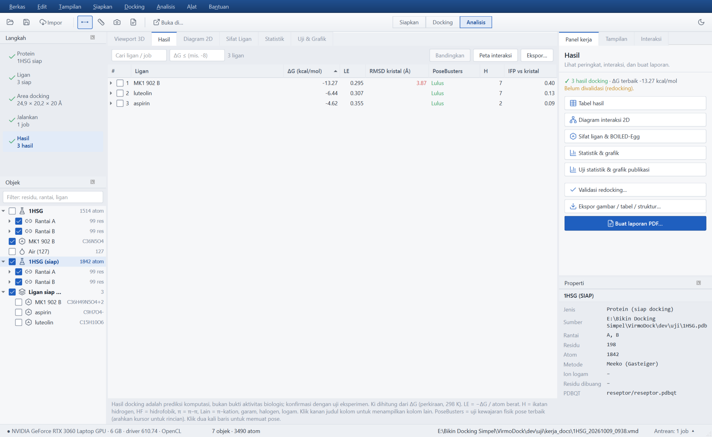

<p align="center"></p>

<p align="center">
  <a href="LICENSE"></a>
  
  <a href="https://github.com/rizkirahmadip-dev/virmolab/releases/latest"></a>
</p>

# VirmoLab

Aplikasi desktop Windows untuk *molecular docking* — gratis dan sumber terbuka (GPL-3.0-or-later).
Satu jendela berbahasa Indonesia (atau Inggris) untuk seluruh alur: impor protein dan ligan, preparasi,
grid box, docking, analisis interaksi, uji statistik, dan ekspor siap publikasi. Tidak perlu Python,
WSL, MGLTools, atau baris perintah.

<p align="center"></p>

## Unduh

Installer dan versi portable ada di halaman
[**Releases**](https://github.com/rizkirahmadip-dev/virmolab/releases/latest):

| Berkas | Untuk |
|---|---|
| `VirmoLab-Setup-<versi>.exe` | pemasangan biasa (per pengguna, tanpa hak administrator) |
| `VirmoLab-Portable-<versi>.zip` | dijalankan dari folder mana saja, termasuk flashdisk |
| `SHA256SUMS-<versi>.txt` | sidik jari untuk memeriksa keaslian unduhan |

Periksa unduhan sebelum dijalankan (PowerShell, di folder unduhan):

```powershell
Get-FileHash .\VirmoLab-Setup-1.9.0.exe -Algorithm SHA256
```

Cocokkan hasilnya dengan baris di `SHA256SUMS-1.9.0.txt`. Installer **belum ditandatangani sertifikat
berbayar**, jadi Windows SmartScreen menampilkan "Windows protected your PC" — klik *More info › Run anyway*
setelah sidik jarinya cocok.

Setelah terpasang, jalankan **Alat › Uji mandiri komponen…** untuk memastikan semua mesin berfungsi
(64 butir), dan ikuti tutorial 1HSG di **Bantuan › Tutorial**.

## Kebutuhan sistem

| | Minimum | Disarankan |
|---|---|---|
| Sistem | Windows 10 64-bit | Windows 10/11 64-bit terbaru |
| RAM | 4 GB | 8 GB atau lebih |
| Ruang disk | ± 1,8 GB + ruang proyek | SSD |
| GPU | tidak wajib (Vina di CPU) | NVIDIA/AMD/Intel dengan driver OpenCL terbaru (AutoDock-GPU) |
| Layar | 1366 × 768 | 1920 × 1080, skala 100–200 % |

## Apa yang bisa dikerjakan

- **Mesin docking**: AutoDock-GPU (OpenCL, Windows asli — NVIDIA/AMD/Intel, tanpa WSL), AutoDock Vina 1.2.7,
  AutoDock 4.2.6, dan Uni-Dock 1.2 (batch GPU, lewat WSL). Mundur otomatis ke Vina bila GPU/OpenCL tidak ada.
- **Preparasi**: reseptor (gemmi, Meeko, PROPKA/PDB2PQR, residu fleksibel, residu hilang), ligan (RDKit + Meeko),
  unduh langsung dari RCSB PDB, AlphaFold DB (pLDDT), PubChem, ChEMBL, COCONUT, LOTUS.
- **Antrean job**: banyak ligan, progres dan perkiraan waktu, jeda/lanjut, dilanjutkan setelah aplikasi ditutup.
- **Analisis**: ikatan hidrogen, hidrofobik, π–π, π–kation, jembatan garam, halogen, logam; tampilan 3D
  (3Dmol.js) dan diagram 2D; PoseBusters; validasi redocking (RMSD); bandingkan 2–4 ligan; peta interaksi;
  uji statistik dan grafik siap publikasi.
- **Sifat & desain ligan**: ADMET, BOILED-Egg, MPO, kemiripan, MMP, fragmen (FBDD), PROTAC, metabolisme,
  farmakofor, QSAR dengan domain aplikabilitas, desain generatif (CReM), dan perbandingan glikosida–aglikon.
- **Simulasi**: MD dan MM/GBSA dengan OpenMM (ff14SB + OpenFF Sage/NAGL, pelarut implisit OBC2 atau air
  eksplisit), xTB, energi bebas relatif (RBFE, OpenFE), co-folding dan docking peptida (Boltz-2),
  skor ulang CNN (GNINA).
- **Farmakologi jaringan** (menu **Jaringan**, Ctrl+Shift+J): satu alur tujuh tahap dari senyawa tanaman
  sampai jalur biologis — kumpulkan senyawa (LOTUS/COCONUT/PubChem atau impor CSV), saring ADMET dan Lipinski,
  cari target (kemiripan ChEMBL dan interaksi terkurasi CTD), iriskan dengan gen penyakit (Open Targets atau
  impor CSV) sebagai diagram Venn, bangun jaringan PPI STRING yang bisa ditelusuri, peringkat protein hub (MCC
  cytoHubba), pengayaan jalur Reactome/GO-BP, lalu paragraf metode siap tempel. Tab **Figur** menghasilkan lima
  gambar siap publikasi — Venn, jaringan berlapis, hub melingkar, bubble plot jalur, batang jalur — sebagai SVG
  vektor atau raster ber-DPI. Ekspor GraphML untuk Cytoscape.
- **Penelitian lanjutan**: penargetan balik, pengayaan jalur dan jaringan (STRING, Reactome, GO),
  konservasi residu kantong, selektivitas, penapisan bertahap (pembelajaran aktif), validasi protokol.
- **Ekspor**: gambar 3D/2D ber-DPI (PNG/TIFF/SVG/PDF), kompleks PDB, SDF, CSV, XLSX, laporan PDF, naskah Word.
- **Distribusi**: installer per pengguna tanpa admin, versi portable, pindah laptop (`.vmdbackup`),
  antarmuka Indonesia/Inggris, tema terang/gelap.

Panduan lengkap ikut terpasang: folder [`docs/`](docs/) atau menu **Bantuan › Panduan pengguna** (F1).

## Alat lanjutan (opsional)

Empat alat hanya tersedia untuk Linux sehingga tidak ikut installer: **Uni-Dock**, **OpenFE**, **GNINA**,
dan **Boltz-2**. Semua fitur inti berjalan tanpanya. Bila diperlukan, pasang dari dalam aplikasi lewat
**Alat › Pasang alat lanjutan (WSL)…** — dialog memeriksa prasyarat (WSL 2, GPU NVIDIA, ruang disk, memori,
internet), menawarkan perbaikan untuk yang belum terpenuhi, lalu memasang ke WSL dengan kemajuan dan log.
Rinciannya di [`docs/instalasi.html`](docs/instalasi.html#alat-lanjutan).

## Privasi

VirmoLab tidak mengirim proyek, struktur, atau hasil Anda ke mana pun, dan tidak memuat telemetri.
Yang menghubungi internet hanya:

- unduhan yang Anda minta sendiri (RCSB PDB, AlphaFold DB, PubChem, ChEMBL, COCONUT, LOTUS, STRING, CTD,
  Open Targets, dan — bila kotaknya dicentang — peladen MSA ColabFold untuk Boltz-2, yang menerima sekuens
  protein yang bersangkutan);
- pemeriksaan pembaruan: satu permintaan GET ke `api.github.com` yang hanya membaca nomor rilis terbaru,
  dapat dimatikan di **Alat › Pengaturan**;
- pemasang alat lanjutan (WSL): unduhan paket dari conda-forge, GitHub, PyPI, PyTorch, dan Hugging Face.

Berkas proyek, log, dan pengaturan tersimpan di komputer Anda saja
(`Documents\VirmoLab`, `%LOCALAPPDATA%\VirmoLab`, `HKCU\Software\VirmoLab`; versi portable menyimpan
semuanya di dalam foldernya sendiri).

## Melaporkan masalah

Lapor lewat [GitHub Issues](https://github.com/rizkirahmadip-dev/virmolab/issues) dengan templat yang
tersedia; sertakan versi VirmoLab, versi Windows, GPU, langkah yang dilakukan, dan berkas log dari
**Bantuan › Laporkan masalah** (`%LOCALAPPDATA%\VirmoLab\log`). Untuk masalah keamanan, ikuti
[`SECURITY.md`](SECURITY.md) — jangan membuat issue publik.

## Cara mengutip

Metadata sitasi ada di [`CITATION.cff`](CITATION.cff) (tombol *Cite this repository* di GitHub).
Dalam publikasi, kutip juga mesin dan pustaka yang dipakai — daftarnya ada di
**Bantuan › Lisensi & cara mengutip** dan ikut tercetak di laporan PDF.

## Baris perintah

`VirmoLab-cli.exe` ada di folder instalasi (dari kode sumber: `python -m virmolab.cli`). Contoh:

```bat
VirmoLab-cli dock -r 1HSG -l kandidat.smi --acuan auto -o hasil_1hsg
VirmoLab-cli dock -r AF-P00918 -l ligan\ --kantong 1 --mesin vina --exhaustiveness 32 -o hasil_ca2
VirmoLab-cli reseptor 1HSG -o rec.pdbqt --protonasi propka --flex A:25,B:25
VirmoLab-cli kantong AF-P00918
VirmoLab-cli mmgbsa -r hasil_1hsg -o mmgbsa_1hsg --md --ns 2
```

`dock` menyiapkan reseptor (berkas PDB/CIF, kode PDB, `AF-<UniProt>`, atau PDBQT siap) dan ligan
(SDF/MOL2/PDB/SMI/PDBQT, folder, atau SMILES) bila perlu, menentukan grid box (`--pusat`, `--acuan`
berkas/`auto`, atau `--kantong N` P2Rank), lalu menulis pose, `ringkasan.csv`, `metode.txt`, dan `log.txt`.
`VirmoLab-cli <perintah> -h` menampilkan semua opsi.

## Menjalankan dari kode sumber

Butuh Windows 10/11 x64 dan Python 3.14.

```bat
py -3.14 -m venv .venv
.venv\Scripts\python.exe -m pip install -r requirements.txt
.venv\Scripts\python.exe -m virmolab
```

Biner mesin docking ada di `vendor/bin/` (AutoDock-GPU dibangun sendiri dari `vendor/adgpu_src/`,
proyek Visual Studio dengan OpenCL; Vina, AutoGrid4, AutoDock4, Open Babel dari rilis resminya).

Deteksi kantong memakai P2Rank + Java yang **tidak ikut repo** (±262 MB). Pasang manual:

- `vendor/bin/p2rank/` — P2Rank 2.5.1 (https://github.com/rdk/p2rank/releases); cukup `bin/`, `config/`,
  dan model `default`, `alphafold`, `_score_transform` (data uji & model lain boleh dibuang).
- `vendor/bin/jre/` — Eclipse Temurin JRE 21 (Windows x64, zip) dari https://adoptium.net, diekstrak
  sehingga ada `vendor/bin/jre/bin/java.exe`.

Uji mandiri (`python -m virmolab --uji-mandiri hasil.json`) memeriksa keduanya.

Modul MD & MM/GBSA memakai OpenMM (PyPI, ada di `requirements.txt`) dan tumpukan OpenFF yang **tidak ada di
PyPI** untuk Windows. Pasang dari arsip rilis GitHub tanpa dependensi (dependensi PyPI-nya sudah ada di
`requirements.txt`):

```bat
set G=https://github.com/openforcefield
set SETUPTOOLS_SCM_PRETEND_VERSION_FOR_OPENFF_UTILITIES=0.1.18
set SETUPTOOLS_SCM_PRETEND_VERSION_FOR_OPENFF_UNITS=0.4.0
set SETUPTOOLS_SCM_PRETEND_VERSION_FOR_OPENFORCEFIELDS=2026.09.0
set SETUPTOOLS_SCM_PRETEND_VERSION_FOR_OPENFF_INTERCHANGE=0.5.5
set SETUPTOOLS_SCM_PRETEND_VERSION_FOR_OPENFF_TOOLKIT=0.19.0
set SETUPTOOLS_SCM_PRETEND_VERSION_FOR_OPENFF_NAGL=0.6.1
set SETUPTOOLS_SCM_PRETEND_VERSION_FOR_OPENFF_NAGL_MODELS=2026.09.0
.venv\Scripts\python.exe -m pip install --no-deps "openff-utilities @ %G%/openff-utilities/archive/refs/tags/v0.1.18.tar.gz" "openff-units @ %G%/openff-units/archive/refs/tags/0.4.0.tar.gz" "openforcefields @ %G%/openff-forcefields/archive/refs/tags/2026.09.0.tar.gz" "openff-interchange @ %G%/openff-interchange/archive/refs/tags/v0.5.5.tar.gz" "openff-toolkit @ %G%/openff-toolkit/archive/refs/tags/0.19.0.tar.gz" "openff-nagl @ %G%/openff-nagl/archive/refs/tags/v0.6.1.tar.gz" "openff-nagl-models @ %G%/openff-nagl-models/archive/refs/tags/v2026.09.0.tar.gz"
```

Variabel `SETUPTOOLS_SCM_PRETEND_VERSION_*` perlu karena arsip GitHub tidak membawa riwayat git (tanpanya
versi terbaca "unavailable"). `openff-amber-ff-ports` tidak diperlukan.

Editor struktur Ketcher juga **tidak ikut repo** (±30 MB): unduh `ketcher-standalone-3.18.0.zip` dari
https://github.com/epam/ketcher/releases (SHA-256 `484e7f10…a3e7e`) lalu ekstrak ke `vendor/ketcher/` cukup
`index.html`, `favicon*`, `static/css/main.*.css`, dan `static/js/main.*.js`, `114.*`, `127.*`, `609.*` (chunk).

## Membuat rilis

1. Pasang [Inno Setup 6](https://jrsoftware.org/isinfo.php) ke `vendor/innosetup/`.
2. Jalankan:

```bat
.venv\Scripts\python.exe build_tools\rilis.py
```

Urutannya: dokumentasi → PyInstaller → uji mandiri (gagal = berhenti) → installer → zip portable →
SHA-256, hasil di `rilis/`.

## Lisensi

VirmoLab: GPL-3.0-or-later ([`LICENSE`](LICENSE)). Komponen pihak ketiga dan tawaran kode sumbernya:
[`LISENSI_PIHAK_KETIGA.txt`](LISENSI_PIHAK_KETIGA.txt) dan folder [`licenses/`](licenses/).

---

## In English

**VirmoLab** is a free, open-source (GPL-3.0-or-later) Windows desktop application for molecular docking.
It covers the whole workflow in one window — importing proteins and ligands, preparation, grid box, docking,
interaction analysis, statistics, and publication-ready export — with no Python, WSL, MGLTools, or command
line required. The interface is available in Indonesian and English (**Tampilan › Bahasa / Language**).

Docking engines: AutoDock-GPU (OpenCL, native Windows), AutoDock Vina 1.2.7, AutoDock 4.2.6, and Uni-Dock 1.2
(GPU batch, via WSL). Optional Linux-only tools (Uni-Dock, OpenFE, GNINA, Boltz-2) install from inside the
app through **Tools › Install advanced tools (WSL)**; core features never need them.

Download the installer or the portable build from the
[Releases](https://github.com/rizkirahmadip-dev/virmolab/releases/latest) page and verify it against
`SHA256SUMS-<version>.txt`. Documentation ships with the application (Help › User guide) and lives in
[`docs/`](docs/) (Indonesian). Bug reports:
[GitHub Issues](https://github.com/rizkirahmadip-dev/virmolab/issues); security reports:
[`SECURITY.md`](SECURITY.md). VirmoLab sends no project data anywhere — see *Privasi* above.

To cite VirmoLab, use [`CITATION.cff`](CITATION.cff) and also cite the engines and libraries you used
(listed under Help › Licenses & how to cite).

---

© 2026 apt. Rizki Rahmadi Pratama, M. Farm
